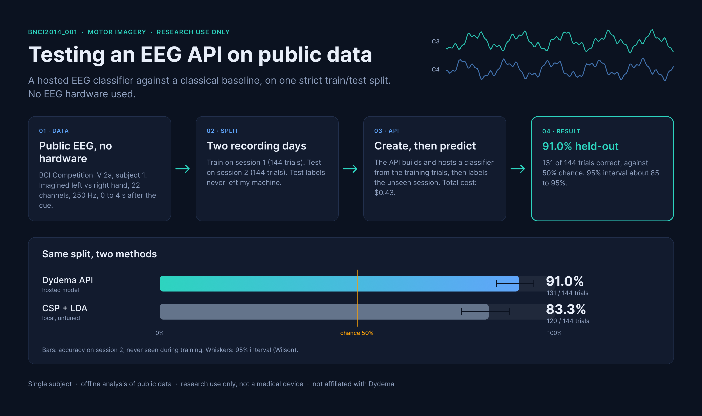
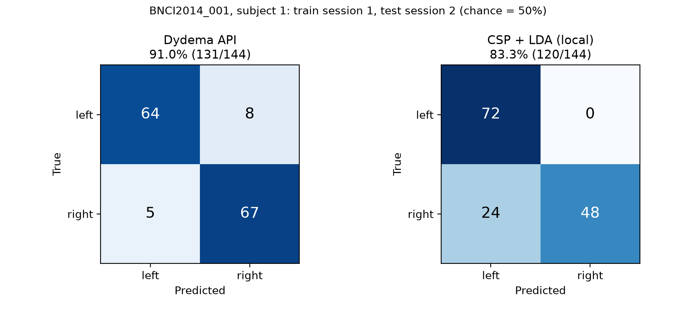

# Testing the Dydema EEG API on public motor-imagery data



A small, honest test of the [Dydema](https://dydema.com) EEG classification API ("Wizard") on a public motor-imagery dataset, compared with a classical local baseline. No EEG hardware was used.

I am a 6th-year medical student building a biosignal engineering portfolio (PPG, ECG, EMG, and later EEG). This repository documents one concrete experiment: how well does a hosted classifier, built from a few labeled trials, work on EEG it has never seen?

> **Research use only.** This is an offline test on public data. It is not a medical device and makes no clinical claim. I am not affiliated with Dydema, and this is not an endorsement.

## Result

| | |
|---|---|
| Dataset | BCI Competition IV 2a (`BNCI2014_001` in MOABB), subject 1 |
| Task | Imagined left-hand vs right-hand movement |
| Trials | 144 train (session 1) / 144 test (session 2), balanced 72 / 72 per class |
| Signal | 22 EEG channels, 250 Hz, 0-4 s after the cue |
| Preprocessing | 8-32 Hz band-pass applied by MOABB (the API applies none), converted to microvolts |
| Validation accuracy (API `training_report`) | 0.861 balanced accuracy (chance 0.50), estimated within session 1 |
| **Held-out accuracy (API)** | **0.910 (131 / 144), chance 0.50** |
| 95% interval (Wilson) | about 0.85 to 0.95 |
| Mean confidence of predicted class | 0.81 |
| Cost | $0.43 in total (144 predictions at $0.003 each) |

**How the split works:** the model was created from session 1 only. Session 2 was recorded on a different day, its labels never left my machine, and the accuracy was computed locally from the API's predictions.

## Comparison with a local baseline

To give the number some context, I ran a standard motor-imagery pipeline locally on the same train/test split: CSP (6 components, log-variance) followed by LDA. Settings were fixed in advance and not tuned on the test session.

| Method | Held-out accuracy | 95% interval (Wilson) |
|---|---|---|
| Dydema API | 0.910 (131 / 144) | 0.85 to 0.95 |
| CSP + LDA (local, untuned) | 0.833 (120 / 144) | 0.76 to 0.89 |



**Reading it:**
- The API scored higher in this run, but the intervals overlap and I did not run a paired test (the API's per-trial predictions were not saved), so I do not claim that one method is better.
- The error patterns differ. The baseline classified all 72 left trials correctly but missed 24 of 72 right trials, a bias toward "left" in session 2. The API's errors were balanced (8 left, 5 right). A shift between the two recording days could explain the baseline's bias, but I did not test that hypothesis.
- The API confusion matrix in the figure is copied from the printed output of `dydema_bci_test.py`.

## Limits

- **One subject.** Subject 1 of this dataset is generally an easy one; other subjects would likely score lower. This says nothing about performance across people.
- One run, one split, no repeated trials or cross-subject test.
- The baseline is a single simple pipeline. Stronger local methods exist, so this comparison says nothing about the API against the best alternatives.
- Offline analysis of public data, not real-time use, not my own recordings.
- The selected method inside the API was not reported in the training report.
- The 8-32 Hz band-pass was applied by me through MOABB, not by the API.

## Reproduce

Requires Python 3.11 and a Dydema API key.

```bash
python3.11 -m venv .venv
source .venv/bin/activate
pip install -r requirements.txt
export DYDEMA_API_KEY="your_key"      # keep it in the environment only

python prepare_data.py                # downloads the dataset, writes subject1_train.npz / subject1_test.npz
python dydema_bci_test.py             # dry run, create, predict, report, optional delete
python baseline_and_figure.py         # local CSP + LDA baseline and confusion_matrices.png
```

`dydema_bci_test.py` does a free dry run first and asks for confirmation before anything is charged. It sets the model to expire after 2 days and offers to delete it at the end, because hosting is billed monthly.

## Files

- `prepare_data.py`: loads the dataset through MOABB, keeps left vs right hand, cuts 0-4 s epochs, saves a train file (session 1) and a test file (session 2).
- `dydema_bci_test.py`: creates the task model from the train file, predicts on the test file, computes held-out accuracy and cost.
- `baseline_and_figure.py`: local CSP + LDA baseline on the same split, and the confusion-matrix figure.
- `result.json`, `result_baseline.json`: outputs of my runs.
- `confusion_matrices.png`: figure shown above.

## References

- Dataset: Tangermann et al., "Review of the BCI Competition IV", Frontiers in Neuroscience, 2012.
- MOABB: Jayaram and Barachant, "MOABB: trustworthy algorithm benchmarking for BCIs", Journal of Neural Engineering, 2018.
- API documentation: https://developers.dydema.com
